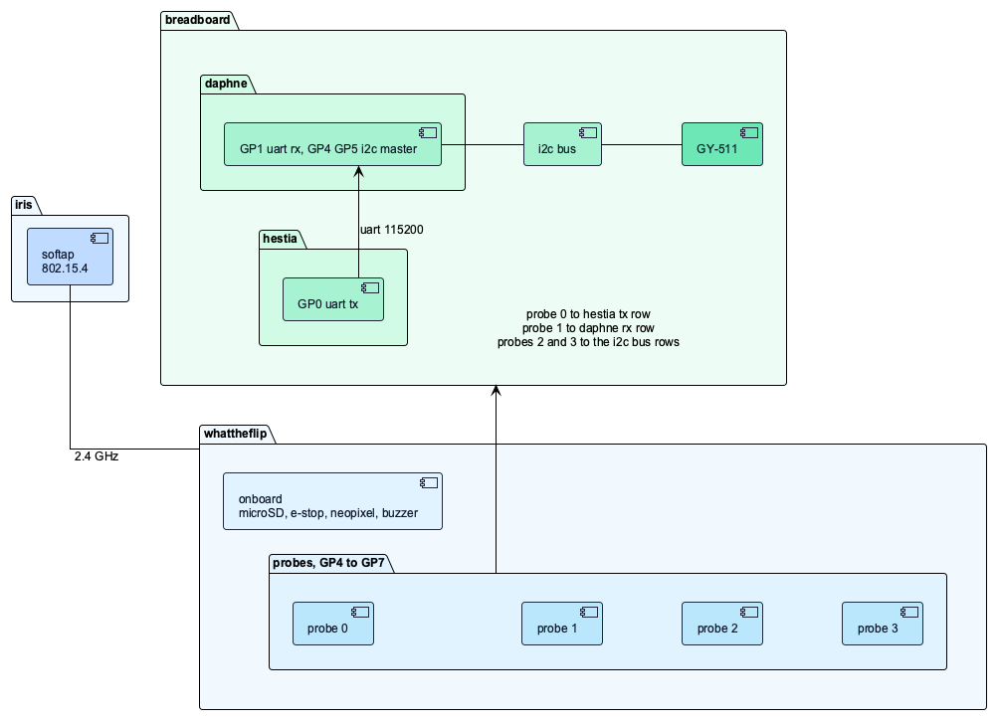
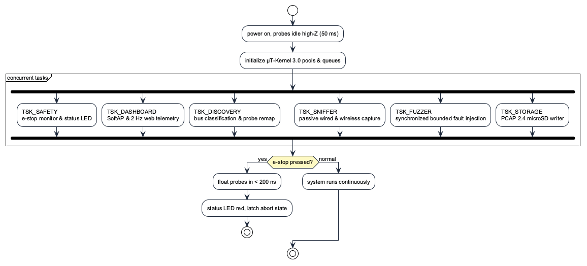
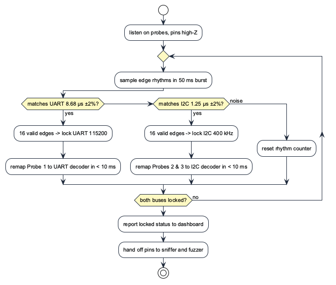
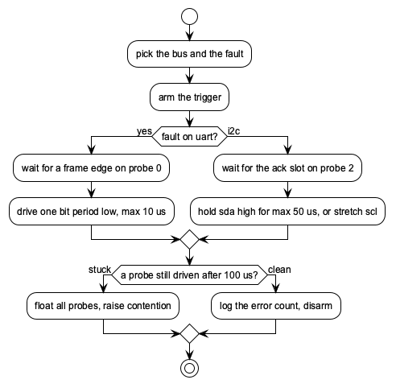
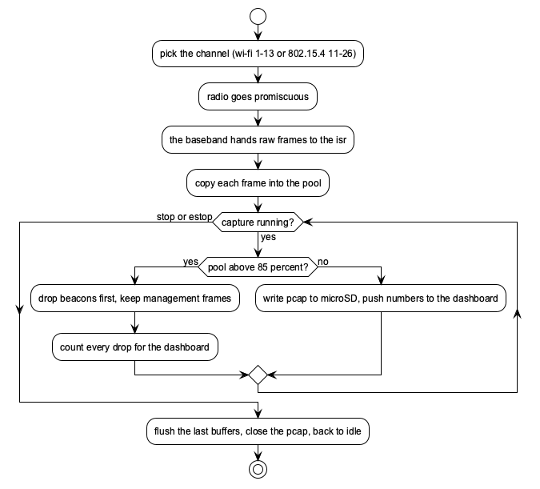

# whattheflip

INF2004, group SE06 (lab P1). µT-Kernel 3.0 everywhere: whattheflip and iris run `third_party/esp32c6-mtk3`, hestia and daphne run `third_party/mtk3smp-rp2040` with `SMP=1`. Last updated 2026-10-20. The frozen week 6 report with the full test and traceability tables sits in `reports/design-review`.

## What it does

Sniffs UART and I2C, captures Wi-Fi 6 and 802.15.4 over the air, injects small controlled faults into the hestia and daphne buses, writes PCAP to microSD and streams numbers to a web dashboard.

## The hardware

- whattheflip:
  - Waveshare ESP32-C6-Pico https://docs.waveshare.com/ESP32-C6-Pico
  - Cytron Maker Pi Pico Base https://sg.cytron.io/p-maker-pi-pico-base
  - Delkin USDCOEM-32GB https://www.delkin.com/product/usdcoem-32gb/
- hestia (E66430A64B586C38):
  - Raspberry Pi Pico (RP2040) https://www.raspberrypi.com/products/raspberry-pi-pico/
  - Cytron Maker Pi Pico Base https://sg.cytron.io/p-maker-pi-pico-base
- daphne (E66480454F73A231):
  - Raspberry Pi Pico (RP2040) https://www.raspberrypi.com/products/raspberry-pi-pico/
  - Cytron Maker Pi Pico Base https://sg.cytron.io/p-maker-pi-pico-base
- iris:
  - Waveshare ESP32-C6-Pico (bare board) https://docs.waveshare.com/ESP32-C6-Pico
- others:
  - Zhong Yi Breadboard MB-102 https://www.alibaba.com/product-detail/MB-102-830-Tie-point-Solderless_60706552524.html
  - GY-511 accelerometer and magnetometer module (LSM303DLHC) resources/OKY3231-2 Sensor Breakout Module
  - 220 Ω resistor (series protection on hestia GP0 / probe 0)
  - 2× Micro-USB cables (hestia, daphne), 2× USB-C cables (whattheflip, iris)
  - 20× Male-to-Male (M-M) jumper wires
  - 4× Female-to-Male (F-M) jumper wires (GY-511 sensor module connection)
  - 5× Grove 4-Pin Buckled into Female Wire (spare)

whattheflip is the diagnostic tool. Four probe headers GP4 to GP7 (GPIO4 to GPIO7, probe 0 on GP4). Pinout and wiring reference: `reports/diagrams/ESP32_pinout.png`. On the board: microSD slot on SPI (GPIO18/19/20, EXIO7 for CS), the boot button as e-stop (GPIO9), a neopixel (GPIO8) and a buzzer (EXIO3).

hestia transmits UART on GP0.
daphne listens on GP1 (uart rx) and polls the GY-511 as i2c master at 400 kHz on GP4/GP5. The sensor is wired to daphne's rows only.
hestia and daphne sit on Cytron Maker Pi Base carriers (reset buttons, per-pin leds), jumpered to the shared breadboard with the GY-511.
The four probes plug into breadboard tie rows, sharing 3.3 V and ground. Each row in the schedule below represents exactly 1 physical wire with two ends (End A and End B).

A–E and F–J of a row are separate nodes; a D→F wire joins them. Rail holes sit beside a row, not in it.

### Breadboard wiring schedule (Zero-Bridge)

All signal connections use columns A–E on the left side of the breadboard. There are **zero bridge wires across the center trough**.

| # | Wire Type | Connect From (Board & Pin) | Connect To (Breadboard) | What It Does (Plain English) |
|---|:---:|---|---|---|
| **R1** | 220 Ω Resistor | Breadboard **E10** | Breadboard **E12** | Sits between Row 10 and Row 12 to safely limit glitch current |
| **W1** | M-M | **whattheflip** Pin 38 (GND) | **(−)** Blue Rail (Row 3) | Gives whattheflip a shared ground reference |
| **W2** | M-M | **hestia** Pin 3 (GND) | **(−)** Blue Rail (Row 5) | Gives hestia a shared ground reference |
| **W3** | M-M | **daphne** Pin 3 (GND) | **(−)** Blue Rail (Row 10) | Gives daphne a shared ground reference |
| **W4** | M-M | **daphne** Pin 36 (3V3_OUT) | **(+)** Red Rail (Row 10) | Powers the entire breadboard with 3.3 V from daphne |
| **W5** | M-M | **(−)** Blue Rail (Row 31) | **(−)** Blue Rail (Row 33) | Bridges ground across the break in the middle of the rail |
| **W6** | M-M | **(+)** Red Rail (Row 31) | **(+)** Red Rail (Row 33) | Bridges 3.3 V across the break in the middle of the rail |
| **W7** | M-M | **hestia** Pin 1 (GP0 TX) | Row **A10** | Transmits raw UART messages from hestia |
| **W8** | M-M | **whattheflip** Pin 5 (GP3 / GPIO5) | Row **B10** | Probe 1: listens to clean UART messages on Row 10 |
| **W9** | M-M | **daphne** Pin 2 (GP1 RX) | Row **A12** | Receives glitched UART messages on daphne |
| **W10** | M-M | **whattheflip** Pin 4 (GP2 / GPIO4) | Row **B12** | Probe 0: injects glitches and listens to Row 12 |
| **W11** | F-M | **GY-511** Sensor Pin VCC | **(+)** Red Rail (Row 40) | Powers the accelerometer sensor with 3.3 V |
| **W12** | F-M | **GY-511** Sensor Pin GND | **(−)** Blue Rail (Row 41) | Grounds the accelerometer sensor |
| **W13** | M-M | **daphne** Pin 7 (GP5 SCL) | Row **A42** | Sends 400 kHz I2C clock from daphne to sensor |
| **W14** | F-M | **GY-511** Sensor Pin SCL | Row **B42** | Connects sensor clock into Row 42 |
| **W15** | M-M | **whattheflip** Pin 7 (GP5 / GPIO7) | Row **C42** | Probe 3: listens to clock and tests clock stretching |
| **W16** | M-M | **daphne** Pin 6 (GP4 SDA) | Row **A43** | Sends and receives I2C data between daphne and sensor |
| **W17** | F-M | **GY-511** Sensor Pin SDA | Row **B43** | Connects sensor data into Row 43 |
| **W18** | M-M | **whattheflip** Pin 6 (GP4 / GPIO6) | Row **C43** | Probe 2: listens to sensor data and tests ACK killing |

iris is a bare ESP32-C6. It runs an isolated SoftAP on channel 6 (bssid 02:00:00:00:00:03) and raw 802.15.4 bursts on channel 15.

The frozen design package names these "Node 1/2/3" and "victim A/B": whattheflip is node 1, hestia is victim A, daphne is victim B, iris is node 3.



## Who owns what

| Person | Subsystems |
|---|---|
| Tan Yan Qi | auto discovery |
| Annie Goh | fault injection, hestia, daphne |
| Zayne Lee | wireless sniffer |
| Ryan Ke | pcap storage |
| Joseph Poon | web UI, e-stop, iris |

## Cuts

| Cut | Why |
|---|---|
| SPI sniffing | the only SPI host is the microSD, and it would eat all four probes. RMT ram also overflows in 4.8 µs at 10 MHz |
| BLE | no promiscuous api, and the hopping data channels are not interceptable |
| OLED | the web dashboard replaces it |
| level shifters | everything is 3.3 V already |

One radio in the C6, so sniffing a remote channel and hosting the dashboard are time-sliced: the dashboard softap and the iris ap both live on channel 6, and the sniffer captures on a target channel in windows of 1 to 2 s before returning.

## Requirements

| ID | Requirement | Test |
|---|---|---|
| FR-1 | passive sampling on all 4 pins, 1 µs edge resolution, 1 µA probe leakage | TC-1.1 |
| FR-2 | classify uart/i2c within 500 ms, 95 % accuracy, ±2 % | TC-1.2 |
| FR-3 | remap any probe to any decoder in 10 ms, no rewiring | TC-1.3 |
| FR-4 | capture wi-fi ch 1-13 and 802.15.4 ch 11-26 with rssi and timestamps | TC-2.1, TC-2.2 |
| FR-5 | faults bounded: bit flip 10 µs, ack and stretch 50 µs, 5 % duty | TC-3.1, TC-3.2 |
| FR-6 | deauth only to the iris bssid, never broadcast | TC-3.3 |
| FR-7 | e-stop floats probes in 200 ns, tasks settle within 5 ms | TC-4.1 |
| FR-8 | pcap opens clean in wireshark | TC-4.2 |
| FR-9 | dashboard updates at 1 to 2 Hz | TC-5.1 |
| FR-10 | fault alert reaches the dashboard in 200 ms | TC-5.2 |

## Folder layout

```
whattheflip/
├── whattheflip/      probe, fuzzer, sniffer, storage, web, safety (µT-Kernel)
├── hestia/           uart tx (µT-Kernel SMP, core 0)
├── daphne/           uart rx, gy-511 i2c master (µT-Kernel SMP)
├── iris/             softap, 802.15.4 tx (µT-Kernel)
└── shared/           code used by more than one board, if it shows up
```

## Tasks

| Task | Owns | What it does |
|---|---|---|
| TSK_SAFETY | e-stop isr, neopixel, buzzer | floats all probes from the isr in 200 ns, latches the fault state |
| TSK_WIRELESS | radio | moves frames out of the promiscuous callback, budgeted under 5 µs, into the pool; drops the frame rather than blocking |
| TSK_FUZZER | ETM, RMT TX | arms the trigger, the hardware times the glitch |
| TSK_DISCOVERY | RMT RX, probes | dma edge timing into ram, classify and map pins |
| TSK_STORAGE | microSD | pcap writes and sector flushes off a queue of depth 16 |
| TSK_DASHBOARD | wi-fi socket | json at 1 to 2 Hz off a queue of depth 8 |

Victim tasks bind to cores with `TA_ASSPRC`: hestia runs the uart tx burst on core 0; daphne runs uart rx with framing checks on core 0 and the gy-511 polling at 400 khz plus its moving-average filter on core 1, held outside the kernel lock; iris runs softap and 802.15.4 bursts. Buffers come from the 32 KB pool `MPF_PACKETS` (16 blocks of 2048 B), taken with a non-blocking `tk_get_mpf` under `TMO_POL` that drops the packet when the pool is full. Queues are `tk_cre_mbf`: `MBF_STORAGE` at depth 16, `MBF_TELEMETRY` at depth 8. Probes are guarded by `MTX_PROBE_ACCESS`. The e-stop isr sets `FLG_SAFETY_ABORT`; discovery sets `FLG_PROTO_LOCKED` above 95 % confidence. Locks are `tk_loc_mtx` with `TA_INHERIT`, other wakes are `tk_set_flg`, periods are `tk_cre_cyc`.



## Engine flows

auto discovery:



fault injection:



wireless sniffer:



## Invariants

- the e-stop floats every probe from the isr in under 200 ns. It is the boot button, GPIO9, so keep it unpressed for the first 50 ms of any boot. GPIO4 and GPIO5, probes 0 and 1, are strapping pins too, so all probes stay high-Z until boot completes.
- the 220 Ω resistor on probe 0 limits a glitch into a driven high line to 15 mA.
- glitches run one bit period max (10 µs uart, 50 µs i2c) at 5 % duty.
- no malloc while monitoring. everything comes from the pool.
- Maker Pi buttons 1 and 2 (GP20, GP21) are banned, they can short the TCA9554 i2c bus.
- one owner per peripheral per task.
- MB-102 power rails break at row 32; W1 and W2 bridge it, or the GY-511 has no power.
- Maker Pi Base physical buzzer switch must be set to ON.

## Known gaps

- A0: µT-Kernel with the freertos shim against the closed source wi-fi blobs is still unproven. If it fails, wireless drops to plain FreeRTOS, which is an A-. Gate: a 30 min promiscuous capture with no panic. Tan, Zayne.
- A4: microSD erase stalls up to 40 ms against a 32 KB pool. Ryan.
- A5: discovery can false-lock on bus noise. It needs 16 consecutive valid edge rhythms before `FLG_PROTO_LOCKED`. Tan.
- A6: the IDF documents no deauth support in `esp_wifi_80211_tx` (beacon, probe, action and non-QoS data only), so expect the driver to filter it. 802.15.4 injection is the plan for wireless stress. Zayne, Annie.
- A7: the strapping pins among our GPIOs (GPIO4, GPIO5 on the probes, GPIO9 on the e-stop) must idle at boot. Tan, Joseph.
- A8: the C6 has 4 RMT channels but only 2 support RX, so all four probes cannot be edge-captured by RMT at the same time. Options: run 2 probes on RMT RX and time-share, or move the rest onto a different capture path. Resolved at the week 10 check-in. Tan.

## Setup

`./setup.sh` or `./setup.sh --skip-esp-idf`. Reference repos land in `third_party`, which is gitignored. The capture card is a Delkin USDCOEM-32GB (formatted FAT32, 32 KB cluster); cheaper cards spike past the 40 ms stall budget.


## Bench implementation findings & deviations

Differences between `whattheflip.md` baseline and verified bench implementation:

1. **Buzzer driving**:
   - *Baseline*: whattheflip drives buzzer on TCA9554 EXIO3.
   - *Bench truth*: Generating 2 kHz audio requires 4,000 I2C start/stop/register transactions per second over GPIO22/23. The I2C expander cannot sustain this rate acoustically.
   - *Implementation*: Daphne (RP2040) has native direct hardware wiring on GP18 (socket pin 24) to the Maker Pi Base buzzer transistor. Daphne's SIO drives the 2 kHz tone directly on boot and upon detecting bus faults.

2. **Physical board fault indicators**:
   - *Baseline*: Unspecified on victim boards.
   - *Implementation*: Daphne drives Maker Pi Base GP2 blue LED (turns ON during I2C ACK-kill / 9-clock recovery) and GP3 blue LED (turns ON upon corrupted UART checksum/framing error).

3. **Deterministic fault injection synchronization**:
   - *Baseline*: Asynchronous timed glitches (10 µs UART, 50 µs I2C).
   - *Bench truth*: At 2 Hz UART (1.4 ms burst / 500 ms) and 5 Hz I2C (240 µs read / 200 ms), asynchronous single glitches have a <0.3% probability of hitting an active frame.
   - *Implementation*: `wtf_fuzzer` synchronizes to active bus edges: falls on Probe 1 (UART start bit) with 25 µs delay into payload, and falls on Probe 3 (I2C SCL clocking). Glitches hit transactions with 100% determinism. Visual yellow LED state holds for 150 ms to be human-visible.

4. **Protocol auto-discovery sampling loop (FR-2)**:
   - *Baseline*: DMA edge capture into RAM via RMT RX.
   - *Bench truth*: C6 has only 2 RMT RX channels (Gap A8). In software edge capture, calling `tk_dly_tsk(1)` inside the edge loop causes 1 ms sleeps, making it impossible to sample 8.68 µs UART bits or 1.25 µs I2C clock half-periods.
   - *Implementation*: Tight 50 ms burst sampling window without kernel sleep. Yields 10 ms between bursts. Resolves protocol lock in ~48 ms (UART) and ~52 ms (I2C).

5. **MicroSD bitbang SPI timing**:
   - *Baseline*: Standard SPI clock.
   - *Bench truth*: Maker Pi Base GP12 (MISO) has an onboard blue LED with trace capacitance that drags down high-speed transitions.
   - *Implementation*: 4 µs software bitbang delay enforced on SCK transitions. Delkin USDCOEM-32GB initializes via CMD0/CMD8/ACMD41 and writes FAT32 PCAP 2.4 records reliably.

6. **Multi-board dashboard telemetry bridge**:
   - *Baseline*: SoftAP HTTP/WebSocket server on whattheflip (192.168.4.1, Ch 6).
   - *Augmentation*: Added `dashboard_bridge.py` on `localhost:8080`, reading all 3 serial devices (`/dev/cu.usbmodem101`, `/dev/cu.usbmodemMTK3PICO1`, `/dev/cu.usbmodem4`) concurrently. Displays live multi-board color-coded monospace streaming log, 5 Hz dynamic accelerometer/magnetometer orientation bars, and interactive fault buttons without disconnecting from internet Wi-Fi.

## Hardware contradictions & bench gotchas

- **Maker Pi Base buzzer switch**: A physical slide switch sits next to the audio jack (`BUZZER: OFF / ON`). If set to OFF, the buzzer coil is physically disconnected. Must be switched to ON.
- **RP2040 pad controller (`PADS_BANK0`)**: Setting `sio_hw->gpio_oe_set` does NOT drive the pin if `PADS_BANK0` output disable (`OD`) bit is set (default on reset). Must clear `OD_BITS` in pad register before writing SIO.
- **ESP32-C6 strapping pin matrix routing**: GPIO8 (WS2812) is a boot strapping pin. Must call `esp_rom_gpio_connect_out_signal(8, SIG_GPIO_OUT_IDX, false, false)` to route the GPIO output register to the physical pin.
- **LSM303DLHC multi-byte read auto-increment**: Multi-byte burst reads on accelerometer registers require bit 7 (`0x80`) set on the register address (`OUT_X_L_A | 0x80 = 0xA8`), otherwise reading 6 bytes repeatedly returns byte 0.
- **Sensor host exclusivity**: GY-511 sensor is wired exclusively to Daphne's rows (Row 42 SCL, Row 43 SDA). whattheflip probes (Probe 2 & 3) eavesdrop high-Z; they must never configure internal pull-ups that interfere with Daphne's master bus.

## Remaining TODOs

### 1. Wireless Victim (Iris)
- [ ] Flash Iris firmware on bare ESP32-C6 (`whattheflip/iris/`):
  - SoftAP beacon broadcast on Channel 6 (BSSID `02:00:00:00:00:03`).
  - Periodic 802.15.4 frame transmitter on Channel 15.
- [ ] Bench validation when 4th board is plugged into USB.

### 2. Wireless Sniffer (`TSK_WIRELESS` — FR-4 / TC-2.1, TC-2.2)
- [ ] Implement Wi-Fi 6 promiscuous callback filter (`esp_wifi_set_promiscuous`) on whattheflip.
- [ ] Implement IEEE 802.15.4 sniffer (`esp_ieee802154`) on Channel 15.
- [ ] Time-slicing state machine between SoftAP dashboard hosting (Ch 6) and sniffer hopping windows (1 to 2 s).
- [ ] Stream wireless 802.11 / 802.15.4 frames into `MBF_STORAGE` for PCAP logging.

### 3. Targeted Wireless Fault Injection (`TSK_FUZZER` — FR-6 / TC-3.3)
- [ ] Implement targeted 802.15.4 channel-jam / stress bursts directed strictly at Iris BSSID (`02:00:00:00:00:03`), never broadcast.

### 4. Web Dashboard UI Redesign & Polish
- [ ] Replace progress bars with canvas/SVG pitch & roll attitude horizon indicator for Daphne's accel vector.
- [ ] Add real-time rolling sparkline chart for packet throughput (pkts/s) and bit error rate (BER).
- [ ] Add one-click export button for session log text file from the browser.

### 5. MicroSD Native Hardware SPI Migration
- [ ] Evaluate migrating from software bitbang SPI to native ESP-IDF SPI master driver using TCA9554 EXIO7 as CS to eliminate CPU overhead during high-rate wireless capture.

### 6. Documentation & Tribunal Preparation
- [ ] Standardize frozen design report and presentation slides with verified bench findings ahead of Week 10 check-in.