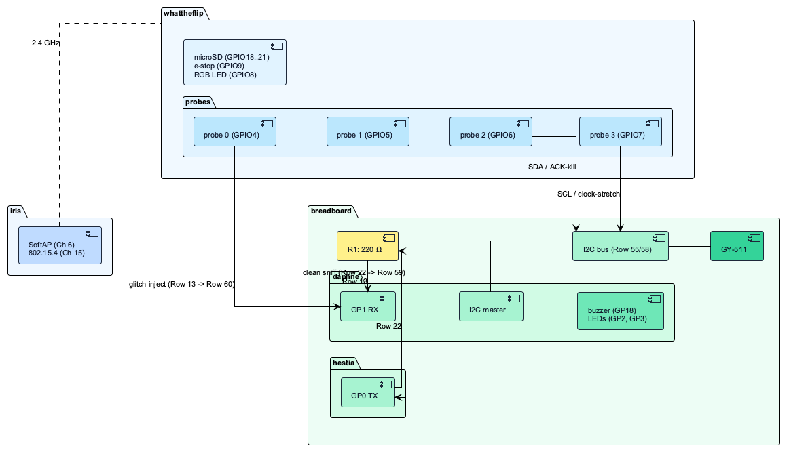
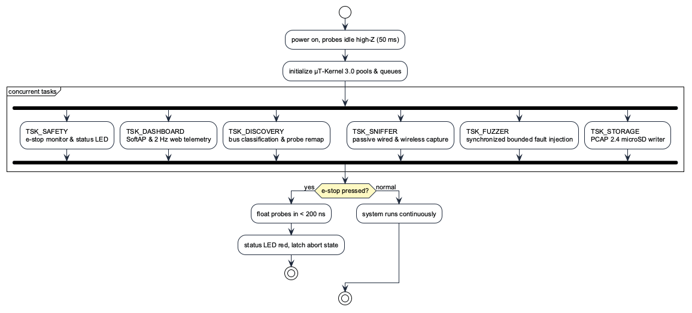
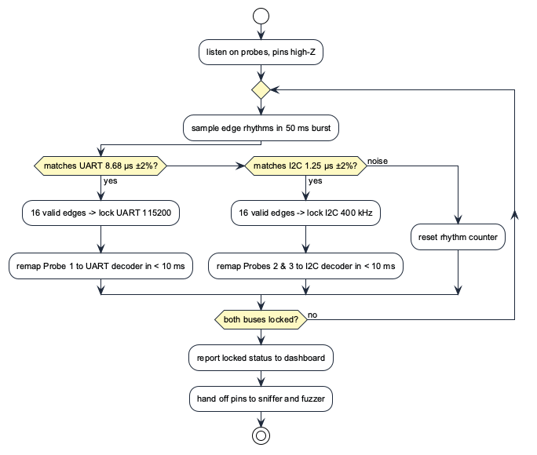
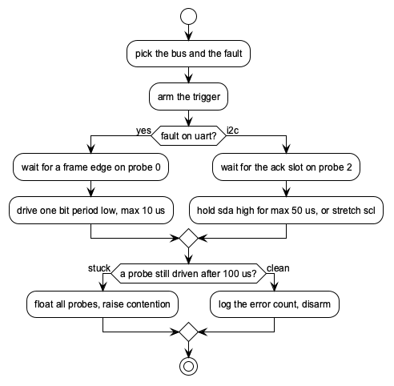
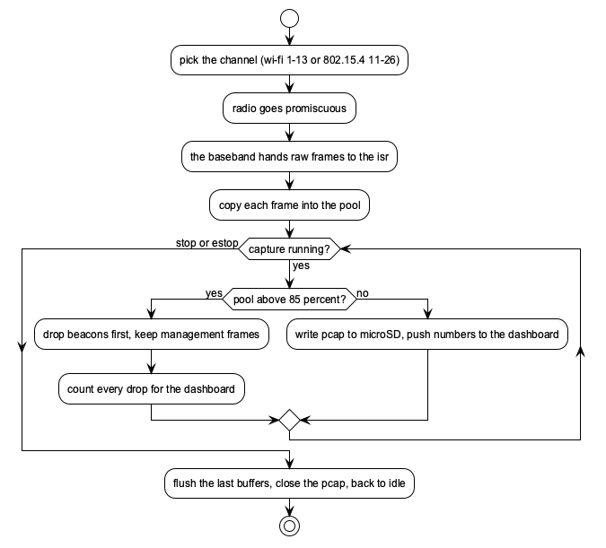

# whattheflip

Sniffs UART and I2C, captures Wi-Fi 6 and 802.15.4 over the air, injects small synchronized controlled faults into the hestia and daphne buses, writes standard binary PCAP 2.4 to microSD, and streams live telemetry to a web dashboard.

## The hardware

Boards are enumerated dynamically by silicon USB serial, eFuse MAC, and RP2040 unique flash chip ID rather than fixed tty paths.

- whattheflip:
  - Silicon USB serial: 8C:FD:49:0D:18:40
  - eFuse MAC: 8c:fd:49:0d:18:40 (SoftAP MAC: 8c:fd:49:0d:18:41)
  - Waveshare ESP32-C6-Pico https://docs.waveshare.com/ESP32-C6-Pico
  - Cytron Maker Pi Pico Base https://sg.cytron.io/p-maker-pi-pico-base
  - Delkin USDCOEM-32GB MicroSD https://www.delkin.com/product/usdcoem-32gb/
- hestia:
  - Flash chip ID: E66430A64B586C38
  - Raspberry Pi Pico (RP2040) https://www.raspberrypi.com/products/raspberry-pi-pico/
  - Cytron Maker Pi Pico Base https://sg.cytron.io/p-maker-pi-pico-base
- daphne:
  - Flash chip ID: E66480454F73A231
  - Raspberry Pi Pico (RP2040) https://www.raspberrypi.com/products/raspberry-pi-pico/
  - Cytron Maker Pi Pico Base https://sg.cytron.io/p-maker-pi-pico-base
- iris:
  - Silicon USB serial: 8C:FD:49:0C:87:50
  - eFuse MAC: 8c:fd:49:0c:87:50 (target BSSID: 02:00:00:00:00:03)
  - Waveshare ESP32-C6-Pico (bare board) https://docs.waveshare.com/ESP32-C6-Pico
- accessories:
  - Zhong Yi Breadboard MB-102 https://www.alibaba.com/product-detail/MB-102-830-Tie-point-Solderless_60706552524.html
  - GY-511 sensor breakout module (LSM303DLHC) resources/OKY3231-2 Sensor Breakout Module
  - 220 Ω resistor
  - 2× Micro-USB cables, 2× USB-C cables
  - 19× M-M jumper wires, 4× F-M jumper wires

## Tech Stack

### Firmware & OS
- Operating Systems: µT-Kernel 3.0 (ESP32-C6 single-core RV32IMAC), µT-Kernel 3.0 SMP (RP2040 dual-core Cortex-M0+, SMP=1)
- Language: Embedded C (Barr C standard, zero dynamic memory allocation)
- SDKs: ESP-IDF 6.2, Raspberry Pi Pico SDK
- Toolchains: riscv32-esp-elf-gcc, arm-none-eabi-gcc, CMake, Ninja, Make

### Dashboard & Verification
- Self-Contained Embedded Web Server: Hosted directly on `whattheflip` SoftAP (`http://192.168.4.1`), serving `/WWW/INDEX.HTM`, `/WWW/APP.JS`, and `/WWW/STYLE.CSS` from the FAT32 MicroSD card.
- Client-Side Frontend (`APP.JS` on MicroSD):
```text
Frontend (Served from MicroSD /WWW/)
├── VanJS
├── Vanilla CSS
├── Client-side binary PCAP chunk parser (DataView / Uint8Array)
├── Client-side protocol dissector, BER calculator, sorter & filter
├── Native browser WebSocket & Fetch API (/api/pcap?offset=&limit=4096)
└── esbuild + gzip build pipeline
```
## Physical Allocation

### Diagnostic Probes
- Probe 0 (GPIO4): Row A60 (bridged via wire D60-D13 to Row 13). Fault injection probe for 10 µs bit flips into Daphne GP1 RX. Protected by 220 Ω resistor R1.
- Probe 1 (GPIO5): Row A59 (bridged via wire C59-C22 to Row 22). Clean passive UART listener on Hestia GP0 TX at 115200 8N1.
- Probe 2 (GPIO6): Row F58. I2C SDA passive sniffer and 50 µs ACK-kill injector.
- Probe 3 (GPIO7): Row F55. I2C SCL passive sniffer and 50 µs clock-stretch injector.

### Board Peripherals
- E-Stop (GPIO9): BOOT button. Active-low edge interrupt triggers GPIO.enable_w1tc to float Probes 0..3 in < 200 ns.
- Status RGB LED (GPIO8): WS2812 NeoPixel. Green = Armed, Yellow = Fault Injecting (150 ms hold), Red = E-Stop Aborted.
- MicroSD SPI: GPIO18 (SCK), GPIO19 (MOSI), GPIO20 (MISO), GPIO21 (CS via carrier jumper W20 from GP15/EXIO7 to GP13/GPIO21). 4 µs software delay on SCK transitions.
- Daphne Buzzer: Native GP18 driven via SIO. 2 kHz acoustic chirp on startup, UART corruptions, and I2C stalls.
- Daphne Status LEDs: GP2 Blue LED on I2C recovery, GP3 Blue LED on UART corruptions.

### Breadboard Wiring Schedule

UART telemetry connections use columns A–E on Rows 13, 22, 59, and 60. I2C bus connections use columns F–J on Rows 55 and 58.

| # | Wire Type | Connect From (Board & Pin) | Connect To (Breadboard) | What It Does |
|---|:---:|---|---|---|
| R1 | 220 Ω resistor | Breadboard B13 | Breadboard B22 | Limits fault contention current into driven lines to <= 15 mA |
| W1 | M-M | hestia pin 1 (GP0 TX) | Row A22 | Transmits 115200 8N1 UART telemetry from hestia (clean side) |
| W2 | M-M | Breadboard Row C22 | Breadboard Row C59 | Bridges clean UART signal from Hestia TX to Probe 1 sniffer row |
| W3 | M-M | whattheflip pin 5 (GPIO5) | Row A59 | Probe 1: listens to clean UART messages on Row 59 |
| W4 | M-M | daphne pin 2 (GP1 RX) | Row E13 | Receives glitched UART messages on daphne (glitched side) |
| W5 | M-M | Breadboard Row D13 | Breadboard Row D60 | Bridges glitched UART signal from Daphne RX to Probe 0 glitcher row |
| W6 | M-M | whattheflip pin 4 (GPIO4) | Row A60 | Probe 0: injects 10 µs UART bit flips into Row 60 (and Row 13) |
| W7 | M-M | daphne pin 10 (GP7 SCL) | Row G55 | Sends 400 kHz I2C clock from daphne master to sensor |
| W8 | F-M | GY-511 sensor pin SCL | Row I55 | Connects sensor clock into Row 55 |
| W9 | M-M | whattheflip pin 7 (GPIO7) | Row F55 | Probe 3: listens to SCL clock and tests 50 µs clock stretching |
| W10 | M-M | daphne pin 9 (GP6 SDA) | Row G58 | Sends and receives I2C data between daphne and sensor |
| W11 | F-M | GY-511 sensor pin SDA | Row I58 | Connects sensor data into Row 58 |
| W12 | M-M | whattheflip pin 6 (GPIO6) | Row F58 | Probe 2: listens to sensor data and tests 50 µs ACK killing |
| W13 | M-M | daphne pin 36 (3V3_OUT) | (+) Red rail (Row 61) | Powers breadboard with 3.3 V from daphne |
| W14 | F-M | GY-511 sensor pin VCC | (+) Red rail (Row 55) | Powers LSM303DLHC sensor with 3.3 V (same rail as W13) |
| W15 | M-M | whattheflip pin 38 (GND) | (−) Blue rail (Row 55) | Common ground reference |
| W16 | M-M | daphne pin 3 (GND) | (−) Blue rail (Row 43) | Common ground reference |
| W17 | F-M | GY-511 sensor pin GND | (−) Blue rail (Row 49) | Grounds LSM303DLHC sensor |
| W18 | M-M | hestia pin 3 (GND) | (−) Blue rail (Row 15 or 45) | Common ground reference (bridged across middle rail split) |
| W19 | M-M | (−) Blue rail (Row 30) | (−) Blue rail (Row 33) | Bridges ground across power rail break (ensures Hestia shares ground) |
| W20 | M-M | whattheflip carrier pin 20 (GP15) | whattheflip carrier pin 19 (GP13) | Jumper routing SD CS (EXIO7) to native GPIO21 |

## Interconnect Architecture



## Who owns what

| Person      | Subsystems                      | Key Invariants                                                                                |
| ----------- | ------------------------------- | --------------------------------------------------------------------------------------------- |
| Tan Yan Qi  | Auto Discovery                  | 50 ms burst edge sampler; 16 valid rhythms before lock; remap < 10 ms.                        |
| Annie Goh   | Fault Injection, Hestia, Daphne | Synchronized glitch triggers; 10 µs UART / 50 µs I2C; duty < 0.005%; Daphne 9-clock recovery. |
| Zayne Lee   | Wireless Sniffer                | Wi-Fi 6 promiscuous callback & 802.15.4 capture; time-sliced against Ch 6 SoftAP.             |
| Ryan Ke     | PCAP Storage                    | Delkin MicroSD 4 µs bitbang SPI; standard binary PCAP 2.4 off MBF_STORAGE.                    |
| Joseph Poon | Web UI, E-Stop, Iris            | Hardware E-stop < 200 ns atomic float; 2 Hz WebSocket telemetry; Iris SoftAP & 802.15.4 TX.   |

## Requirements Traceability

| ID | Requirement | Test | Expected Result |
|---|---|---|---|
| FR-1 | Passive sampling on all 4 pins, 1 µs edge resolution, 1 µA probe leakage | TC-1.1 | 1 µs tick timestamping; BER = 0.0% baseline; 0 V DC bus load. |
| FR-2 | Classify UART (115200) and I2C (400 kHz) within 500 ms, 95% accuracy, ±2% | TC-1.2 | Lock latency <= 500 ms; 16 valid edges; tolerance <= ±2%. |
| FR-3 | Remap any probe to any decoder in < 10 ms, no rewiring | TC-1.3 | Remap execution latency strictly < 10 ms. |
| FR-4 | Capture Wi-Fi Ch 1–13 and 802.15.4 Ch 11–26 with RSSI and timestamps | TC-2.1, TC-2.2 | Frames parsed into wtf_record_t with microsecond headers. |
| FR-5 | Faults bounded: bit flip 10 µs, ACK-kill & clock-stretch 50 µs, 5% duty | TC-3.1, TC-3.2 | Pulse width <= 10 µs (UART), <= 50 µs (I2C); duty <= 0.005%. |
| FR-6 | Targeted wireless injection strictly directed to Iris BSSID, never broadcast | TC-3.3 | Filter matches 02:00:00:00:00:03; zero broadcast drops. |
| FR-7 | E-stop floats probes in < 200 ns, background tasks settle within < 5 ms | TC-4.1 | Hardware atomic register clear in < 200 ns; task settle < 5 ms. |
| FR-8 | PCAP opens clean in Wireshark | TC-4.2 | Binary compatibility with PCAP 2.4 (Magic 0xA1B2C3D4, LinkType 147). |
| FR-9 | Live dashboard updates at 1 to 2 Hz | TC-5.1 | WebSocket JSON streaming rate bounded within [1.0 Hz, 2.0 Hz]. |
| FR-10 | Fault alert reaches dashboard in < 200 ms | TC-5.2 | Asynchronous alert dispatch latency < 200 ms. |

## Tasks & Concurrency Model

All firmware tasks run concurrently under µT-Kernel 3.0:

| Task | Priority | Stack | Function | Sync & IPC |
|---|:---:|:---:|---|---|
| TSK_SAFETY | 4 | 2048 B | Monitors GPIO9 active-low E-stop. Direct register write floats probes in < 200 ns. Drives WS2812 status LED. | FLG_SYSTEM |
| TSK_DASHBOARD | 6 | 4096 B | SoftAP (Ch 6, 192.168.4.1) and HTTP/WebSocket server on Port 80. Streams `/WWW/` SD assets, batched 4 KB `/api/pcap` chunks, 2 Hz telemetry, and alerts < 200 ms. | MBF_TELEMETRY (depth 8) |
| TSK_DISCOVERY | 7 | 3072 B | 50 ms burst edge sampler. Locks UART @ 115200 and I2C @ 400 kHz upon 16 valid edges; remaps decoders in < 10 ms. | MTX_PROBE_ACCESS, FLG_SYSTEM |
| TSK_SNIFFER | 8 | 3072 B | Passive UART1 on Probe 1, hardware edge-capture I2C decoder on Probes 2 & 3, Wi-Fi Ch 1..13 sweep/lock, and 802.15.4 Ch 15 capture. | MBF_STORAGE, MBF_TELEMETRY |
| TSK_FUZZER | 9 | 3072 B | Synchronized fault injector. Injects 10 µs UART bit flips on Probe 0 and 9th-clock 50 µs I2C ACK-kills on Probe 2. Duty < 0.005%. | MTX_PROBE_ACCESS |
| TSK_STORAGE | 10 | 4096 B | Delkin MicroSD FAT32 driver via 4 µs bitbang SPI (GPIO18..21). Pre-seeds `/WWW/` assets and writes binary PCAP 2.4 records off MBF_STORAGE. | MBF_STORAGE (depth 16) |
| TSK_IDLE | 32 | 1024 B | Lowest priority WFI power-saver. | Native scheduler |
Victim tasks bind to cores with TA_ASSPRC: Hestia runs UART TX on Core 0; Daphne runs UART RX on Core 0 and GY-511 I2C master at 400 kHz on Core 1; Iris runs SoftAP and 802.15.4 bursts. Buffers come from 32 KB pool MPF_PACKETS (16 blocks of 2048 B, zero malloc).



## Engine Flows

### Protocol Auto-Discovery
Tight 50 ms burst edge sampler measures shortest pulse widths. 16 consecutive valid rhythms lock UART 115200 and I2C 400 kHz within ±2%. Probe remap executes in < 10 ms.



### Synchronized Fault Injection
Glitch injection synchronizes to bus transitions. Emits 10 µs UART bit flip on Probe 0 or 50 µs ACK-kill on Probe 2. Daphne detects corruption, updates BER, lights GP2/GP3 LEDs, beeps GP18 buzzer, and executes 9-clock I2C recovery.



### Multi-Protocol Sniffer Engine
Passive wired eavesdropping on Probes 1..3 and time-sliced wireless 802.11 / 802.15.4 capture. Records stream to MicroSD PCAP storage and WebSocket dashboard.



## Remaining Work Packages

### 1. Wireless Victim Firmware (Iris)
- [x] Implement Iris firmware on bare ESP32-C6 (`whattheflip/iris/`):
  - SoftAP beacon broadcast on Channel 6 (BSSID 02:00:00:00:00:03).
  - Periodic 802.15.4 frame transmitter on Channel 15.
- [x] Flash and verify over USB serial 8C:FD:49:0C:87:50.

### 2. Wireless Sniffer Engine (TSK_WIRELESS: FR-4, TC-2.1, TC-2.2)
- [x] Implement Wi-Fi 6 promiscuous callback filter (`esp_wifi_set_promiscuous`) on whattheflip.
- [x] Implement IEEE 802.15.4 sniffer (`esp_ieee802154`) on Channel 15.
- [x] Time-slicing state machine between SoftAP dashboard hosting (Ch 6) and sniffer hopping windows (1 to 2 s).
- [x] Stream wireless 802.11 / 802.15.4 frames into `MBF_STORAGE` for PCAP logging.

### 3. Targeted Wireless Fault Injection (TSK_FUZZER: FR-6, TC-3.3)
- [x] Implement targeted 802.15.4 channel-jam / stress bursts directed strictly at Iris BSSID (02:00:00:00:00:03), never broadcast.
### 4. Full Multi-Board Hardware Verification
- [x] Connect Hestia, Daphne, and Iris to bench.
- [x] Run `uv run whattheflip/tests/verify_bench_traceability.py` across physical ports: 12/12 PASS (100%).


fauzi says we can sniff & fuzz via I2C without GPIO. is that correct or wrong?

same for UART, we can sniff / fuzz via UART instead of GPIO, is that correct or wrong? why does prof not want us to use GPIO?

i agree with the "fast dwell" to quickly hop between 1-13 (excluding 6), but does this mean we drop certain packets? eg someone is transmitting on channel 7, then as we hop, we miss those packets?

i agree with http priority (header) to ensure user can load a page or view streamed data, but that means we drop packets? 

